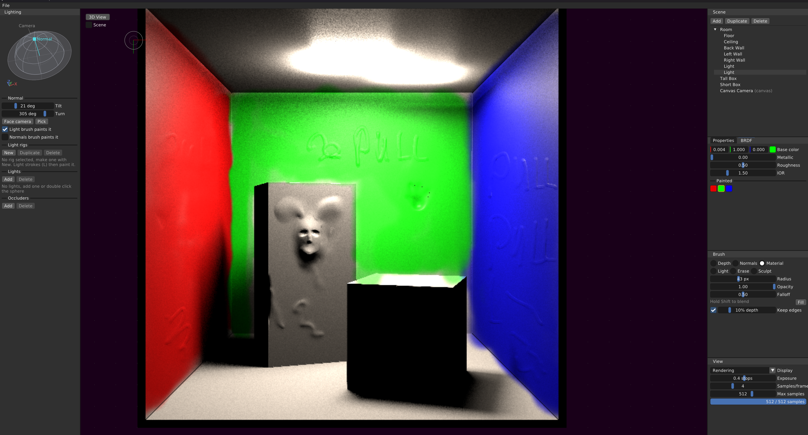

# Lustrious Paint

A digital painting application where you paint form and material, and the light is rendered.

In traditional painting, rendering is a final, manual step once the form is established. Here rendering is continuous feedback: every canvas pixel is a point in 3D space with a surface normal, a material and a light rig, and the canvas is lit by physically based rendering as you paint. You block in a scene from simple SDF shapes, paint its depth onto the canvas, sculpt it, paint normals and materials, and light regions the way a painter would, with lights and shadows that only reach where you paint them.



See [SPECIFICATION.md](SPECIFICATION.md) for the design and the questions still open.

## Painting model

Each canvas pixel stores:

- **Position**: a distance along the canvas camera's ray through the pixel, so a point can never leave its pixel.
- **Normal**: painted, or implied by the neighbouring positions where none is painted.
- **Material**: the parameters of a BRDF (base colour, metallic, roughness, IOR), the metallic-roughness model of glTF 2.0 with pbrt-v4's Trowbridge-Reitz microfacets.
- **Light rig**: which of the canvas's local lights and occluders reach the pixel, on top of the scene's own emitters.

The **Rendering** view solves the rendering equation for direct light at every painted point, sampling emitters and the BRDF with multiple importance sampling, and accumulates samples over frames.

## Brushes

| Mode | Key | What a stroke does |
|---|---|---|
| Depth | `B` | Paints positions traced from the construction geometry |
| Normals | `N` | Paints normals from the construction geometry, or the Lighting panel's normal |
| Material | `M` | Paints the BRDF panel's material |
| Light | `L` | Paints the selected light rig, with its normal |
| Erase | `E` | Removes positions and normals, back to the default material and no rig |
| Sculpt | `S` | Pulls the surface towards the camera or pushes it away (`X` switches), optionally along the surface normal |

- **Shift** while painting blends instead: it smooths depth, normals or materials, keeping object edges apart. With the Light brush it paints no rig.
- **Alt+click** picks the normal under the brush, averaged over it, and the rig under it.
- **F** fills the whole canvas with the brush.
- **`[` `]`** change the brush size, **Shift+`[` `]`** its falloff, and **`1`…`0`** set its opacity from 10% to 100%.
- Strokes respect opacity and falloff: overlapping dabs of one stroke don't add up past its opacity. Sculpting and blending build up instead.

## Lighting

The **Lighting** panel shows a surface patch with the hemisphere over it.

- **Local lights** are small disks of sky set relative to the camera, with colour, intensity, size and optional shadowing by the scene's shadow casters.
- **Occluders** are caps of directions that shadow the light coming from within them.
- **Light rigs** group lights and occluders. Each pixel refers to the rig painted on it, so changing a rig, light or occluder changes every pixel it reaches. The rig list shows how much of the canvas each rig covers.
- **Normal**: drag the handle on the patch or set its tilt and turn. Light strokes, and optionally normal strokes, paint it.

## Views

**View → Display** switches between Depth, Position, Normal, Rendering, Material, Rigs and a red wax **Matcap** for judging form. The **3D View** button flies out of the canvas into the scene for placing shapes, lights and the camera.

## Files

**File → Save** (`Ctrl+S`), **Save As** (`Ctrl+Shift+S`) and **Open** (`Ctrl+O`) use `.lspaint` files. They hold the scene, the painted canvas, the lights, occluders and rigs, the materials and the render settings, in a chunked binary format described in [Application/Include/LsDocument.h](Application/Include/LsDocument.h). Rendered samples are rendered again after opening.

## Building

Windows, with:

- Visual Studio 2022
- CMake 3.16 or newer
- The [LunarG Vulkan SDK](https://vulkan.lunarg.com/) 1.3.296 or newer, which provides `slangc` for the shaders and SDL3. Set `VULKAN_SDK`.

```bash
cmake -S . -B Build
```

```bash
cmake --build Build --config Debug
```

The application is built to `Build/Application/Debug/LustriousPaint.exe`, with its compiled shaders next to it.

Linux (Ubuntu 22.04), with GCC, CMake and the [LunarG Vulkan SDK](https://vulkan.lunarg.com/sdk/home#linux) tarball for `slangc` and the Vulkan headers. Source its `setup-env.sh` so `VULKAN_SDK` is set. Ubuntu 22.04 has no SDL3 package, so CMake fetches SDL3 and builds it, which needs Git and the X11 and Wayland development packages:

```bash
sudo apt install build-essential cmake git libvulkan-dev libx11-dev libxext-dev libxrandr-dev libxcursor-dev libxi-dev libxss-dev libxtst-dev libxkbcommon-dev libwayland-dev libegl1-mesa-dev libdbus-1-dev libudev-dev
```

```bash
cmake -S . -B Build -DCMAKE_BUILD_TYPE=Debug
```

```bash
cmake --build Build -j
```

The application is built to `Build/Application/LustriousPaint`. An SDL3 that is already installed is used instead when CMake finds it, for example through `CMAKE_PREFIX_PATH`.

Defining `FRAME_RECORDING` (see `Libraries/LsRenderer/CMakeLists.txt`) makes F12 start and F11 stop writing every presented frame to a numbered BMP file.

## Layout

| Folder | Contents |
|---|---|
| `Application` | The application: canvas painting, the Lighting panel, the scene editor and 3D view, documents |
| `Libraries/LsRenderer` | Vulkan rendering: the canvas and its attributes, the 3D view |
| `Libraries/LsScene` | The scene of SDF shapes, cameras and its undo history |
| `Shaders` | Slang shaders: `canvas.slang` paints, blends, sculpts and renders the canvas, `brdf.slang` the BRDF, `scene.slang` the shapes |
| `Docs` | Notes and papers |
